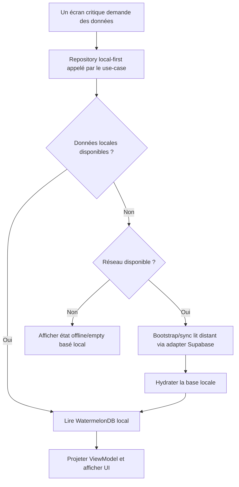
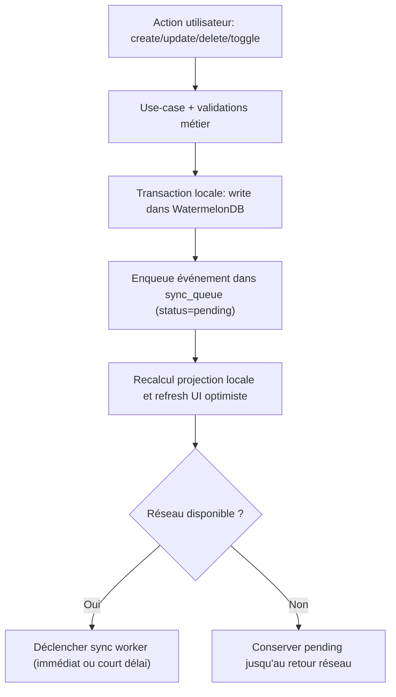
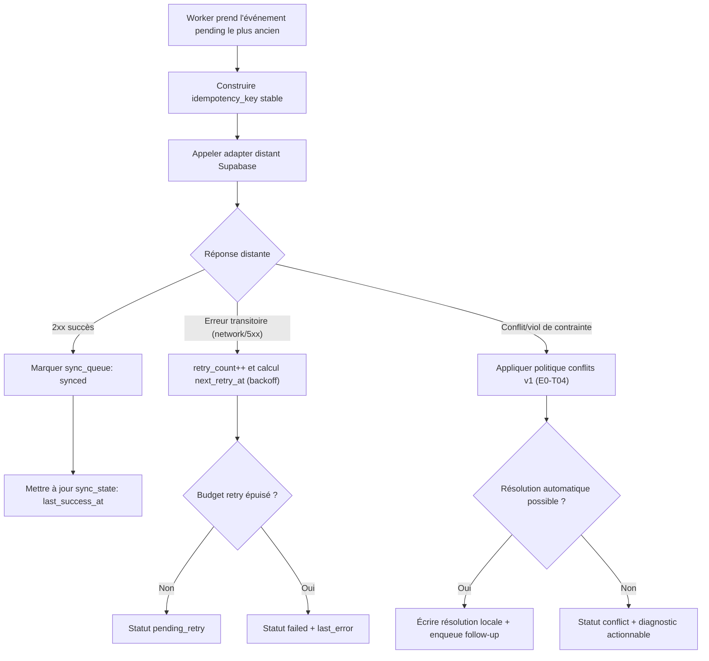
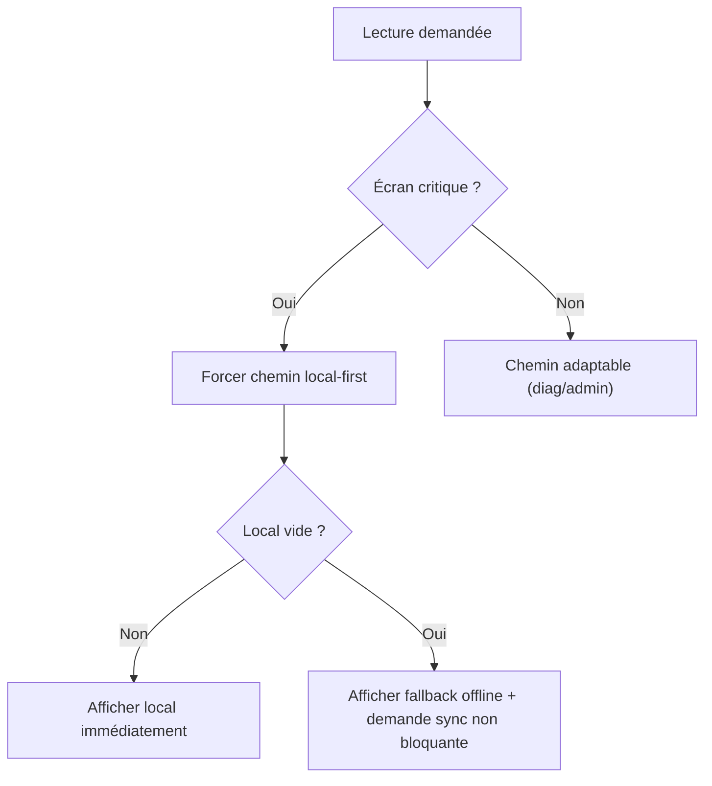

# E0-T03 — Flux Lecture / Écriture / Sync (Offline-First v1)

**Statut :** Proposé (en revue)  
**Date :** 2026-03-31  
**Ticket :** E0-T03  
**Dépendance :** E0-T01 ([ADR-0001](./adr/ADR-0001-offline-first-architecture.md))

---

## Objectif

Formaliser les flux de référence `local -> outbox -> remote` pour les parcours critiques, avec points de décision explicites.

## Précondition d'entrée offline

- Onboarding auth (signup, login initial, vérification email) = online-only.
- Les flux ci-dessous s'appliquent aux parcours métier après authentification et session locale disponible.

---

## Diagramme 1 — Lecture UI critique

Règle: la UI ne lit jamais Supabase directement.

---

## Diagramme 2 — Écriture métier critique

Règle: pas de write distant direct depuis un composant UI critique.

---

## Diagramme 3 — Exécution Sync Worker

Règle: un événement n'est `synced` qu'après ACK distant.

---

## Diagramme 4 — Décision de lecture selon contexte réseau

Règle: même online, un écran critique lit local d'abord.

---

## Walkthrough Scénarios (QA)

| ID | Scénario | Chemin attendu | Résultat attendu |
|---|---|---|---|
| S0 | Utilisateur non authentifié sans réseau | Hors scope flux métier offline-first | Impossible de créer/valider un compte offline |
| S1 | Lecture écran home en offline avec local déjà hydraté | Diagramme 1: `local available` | UI complète sans appel réseau |
| S2 | Lecture cold-start avec local vide et réseau disponible | Diagramme 1: `local missing -> remote hydrate -> local read` | UI après hydration locale, sans couplage direct composant->Supabase |
| S3 | Toggle tâche online | Diagramme 2 + 3: `local write -> enqueue -> sync success` | Feedback immédiat + event `synced` |
| S4 | Toggle activité offline puis reconnexion | Diagramme 2 puis 3 différé | Mutation conservée localement puis propagée à la reconnexion |
| S5 | Sync en erreur transitoire | Diagramme 3: `retry/backoff` | Pas de perte mutation; retry programmé |
| S6 | Conflit distant sur update | Diagramme 3: branche conflit | Event marqué `conflict` ou résolu selon politique E0-T04 |

---

## Checklist parcours (DoD E0-T03)

- Chaque lecture critique passe par repository local-first.
- Chaque écriture critique crée une entrée `sync_queue`.
- Les statuts `pending/synced/pending_retry/failed/conflict` sont couverts par les flux.
- Les chemins offline (sans réseau) restent fonctionnels pour les parcours critiques.
- Le flux conflit référence explicitement E0-T04.

---

## Observabilité minimale attendue

- `sync_queue.size`, `sync_queue.pending_count`, `sync_queue.failed_count`.
- `sync_worker.last_success_at`, `sync_worker.last_error`.
- `sync_worker.retry_count` par événement.
- `conflict.count` et `conflict.last_entity`.

---

## Hors portée (rappel ticket)

- Détails par feature écran par écran.
- Algorithme complet de résolution des conflits (traité en E0-T04).
