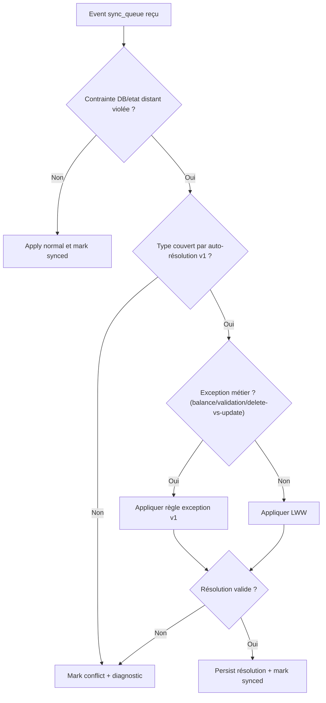

# E0-T04 — Politique Conflits v1 (LWW + Exceptions)

**Statut :** Proposé (en revue)  
**Date :** 2026-03-31  
**Ticket :** E0-T04  
**Dépendances :** E0-T03 ([flux](./E0-T03-read-write-sync-flows.md))

---

## Objectif

Définir une politique v1 simple, déterministe et opérable pour résoudre les conflits de synchronisation offline-first.

---

## Principes v1

1. Règle par défaut: `LWW` (Last Write Wins) pour les entités non cumulatives.
2. Toute résolution doit être déterministe (même entrée -> même sortie).
3. En cas d'ambiguïté non couverte, ne pas fusionner "à moitié": marquer `conflict` avec diagnostic.
4. Les écritures métier critiques restent `local-first`; la résolution a lieu au niveau sync worker.

---

## Définitions

- **Mutation**: opération `create|update|delete` issue de la `sync_queue`.
- **Horodatage logique mutation**: `mutation_ts_ms` stocké dans l'événement outbox.
- **Clé de tie-break**: `mutation_id` stable et ordonnable (UUID v7 recommandé).
- **Conflit**: divergence entre l'état local candidat et l'état distant au moment de l'apply.

---

## Algorithme LWW v1 (générique)

Entrées minimales par événement:
- `entity_type`
- `entity_id`
- `op`
- `payload`
- `mutation_ts_ms`
- `mutation_id`

Ordre de décision:
1. Comparer `mutation_ts_ms` local vs version distante connue.
2. Le plus récent gagne.
3. En cas d'égalité stricte sur `mutation_ts_ms`, comparer `mutation_id` (ordre lexical).
4. Si toujours indécidable (cas pathologique), conserver distant et marquer `conflict_manual`.

---

## Exceptions à LWW (v1)

| Cas | Politique v1 | Raison |
|---|---|---|
| `profiles.balance` | Valeur issue de `validate_day` distante prioritaire | Champ cumulatif sensible; éviter double crédit |
| `daily_validations` | Idempotence stricte `(profile_id, check_date)`; première validation acceptée | Éviter validation multiple d'une journée |
| `daily_checks` (toggle) | Dernier état booléen gagne, jamais cumul d'étoiles local-only | Éviter dérive de score par retry |
| `delete` vs `update` sur même entité | `delete` gagne si timestamp >= update | Prévenir résurrection involontaire |
| Contraintes d'intégrité (FK/unique) | Ne pas forcer merge; marquer `conflict` | Préserver cohérence référentielle |

---

## Matrice de résolution par type de donnée

| Type | Stratégie | Auto-résolution v1 | Sortie en échec |
|---|---|---|---|
| `profiles` (hors `balance`) | LWW | Oui | `conflict` |
| `moments/activities/tasks` | LWW | Oui | `conflict` |
| `profile_moments` | LWW + ordre `sort_index` | Oui | `conflict` |
| `profile_moment_activities` | LWW + `sticker_key` non vide | Oui | `conflict` |
| `profile_moment_activity_tasks` | LWW | Oui | `conflict` |
| `daily_checks` | Dernier booléen gagne | Oui | `conflict` |
| `daily_validations` | Idempotence par clé métier | Oui | `failed` (si violation non récupérable) |
| `profiles.balance` | Remote `validate_day` prioritaire | Oui | `conflict_manual` |

---

## Diagramme décisionnel (worker)

---

## Contrat de traçabilité minimal

Pour chaque conflit détecté, journaliser:
- `event_id`
- `entity_type`
- `entity_id`
- `local_mutation_ts_ms`
- `remote_version_ts_ms` (si disponible)
- `policy_applied` (`lww|exception|manual`)
- `resolution_status` (`synced|conflict|conflict_manual|failed`)
- `reason_code` (ex: `unique_violation`, `fk_violation`, `delete_wins`)

---

## Cas limites explicitement couverts

- Device A offline met à jour entité X; Device B online met à jour X ensuite:
  `B` gagne si timestamp plus récent.
- Device A supprime X offline; Device B modifie X online:
  `delete` gagne si `delete.ts >= update.ts`, sinon update gagnant et delete en conflit.
- Retry réseau d'un même event:
  idempotence via `mutation_id`, pas de duplication d'effet.
- Deux validations du même jour:
  unicité `(profile_id, check_date)`, seconde tentative devient no-op ou conflit tracé.

---

## QA minimale (E0-T04)

| ID | Scénario | Attendu |
|---|---|---|
| C1 | Update concurrent sur `profiles.name` | Résolution LWW déterministe |
| C2 | Delete vs update sur `profile_moment_activity_tasks` | Règle delete-vs-update respectée |
| C3 | Double retry même event `daily_checks` | Aucun doublon ni sur-crédit |
| C4 | Double `validate_day` même date | Idempotence maintenue |
| C5 | FK cassée pendant apply | Event marqué `conflict` avec `reason_code` |

---

## Rollback

Si la politique v1 provoque trop de conflits non résolus:
1. Revenir à la variante conservatrice "remote wins" pour les types non critiques.
2. Garder `profiles.balance` et `daily_validations` sous règles strictes actuelles.
3. Rejouer les événements `conflict` après ajustement.

---

## Hors portée v1

- Merge collaboratif champ par champ.
- Résolution sémantique multi-acteurs avancée.
- UI de résolution manuelle complète (seulement diagnostics v1).
